# MYWMS — Database ERD

> Generated from the Sequelize model definitions in [src/models/](../src/models/) and the
> association graph in [association.js](../src/models/association.js).
> Diagrams use [Mermaid](https://mermaid.js.org/syntax/entityRelationshipDiagram.html) — they render
> natively on GitHub, GitLab, and in VS Code's Markdown preview.

---

## 1. Architecture — two tiers of databases

MYWMS is **multi-tenant with database-per-tenant isolation** ([tenantMenager.service.js](../src/db/tenantMenager.service.js)):

| Tier | Database | Contents | Defined by |
|---|---|---|---|
| **Root / Central** | `mywms` (single) | Tenant registry, cross-company trade documents (RFQ → Quotation → Blanket Order → Indent), inter-company requisitions, product mappings | `defineRootModels()` |
| **Tenant** | one PG database per tenant, created on signup | Everything operational: products, nodes, stores, procurement, inventory, production, sales, costing | `defineTenantModels()` |

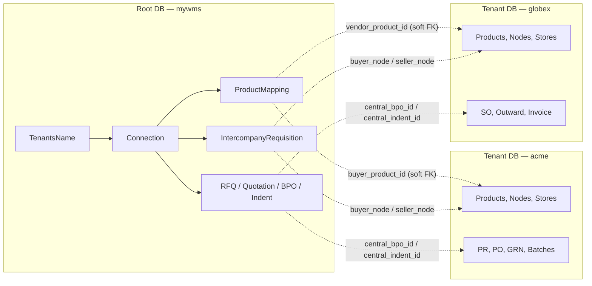

**Key consequence:** any reference that crosses a database boundary is a *soft* foreign key — a plain
integer/string column with **no database-level constraint**. These are listed in [§5](#5-cross-database-soft-references).

Every table carries Sequelize's implicit `id` (PK, auto-increment) plus `createdAt` / `updatedAt`,
except `State` and `District`, which are declared `timestamps: false`.

---

## 2. Root DB ERD

### 2.1 Tenant registry, identity & geography

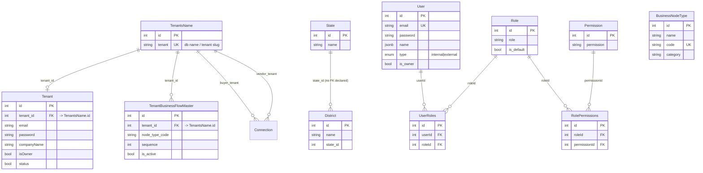

`TenantBusinessFlowMaster` has a composite unique index `uniq_tenant_node_type` on
`(tenant_id, node_type_code)`.

### 2.2 Trading partnership & product mapping

`Connection` is the hub of the root DB — it pairs two tenants and every cross-company document
hangs off it.

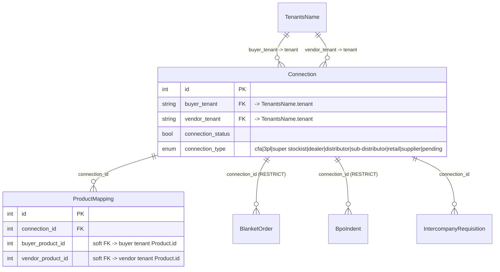

### 2.3 RFQ → Quotation → Blanket Order → Indent

The full central sourcing pipeline. An RFQ is broadcast by a buyer tenant; vendor tenants answer
with quotations that carry versioned revisions; an accepted revision becomes a Blanket Purchase
Order (BPO); releases against that BPO are Indents, which materialise as a PO in the buyer's tenant
DB and an SO in the vendor's.

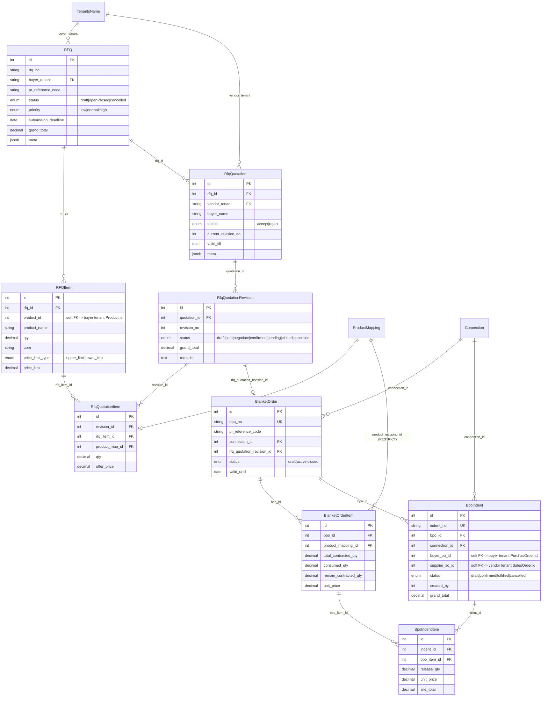

### 2.4 Inter-company requisitions

A lighter-weight flow than the BPO chain: one tenant's node requisitions stock directly from a
partner tenant's node over an existing `Connection`.

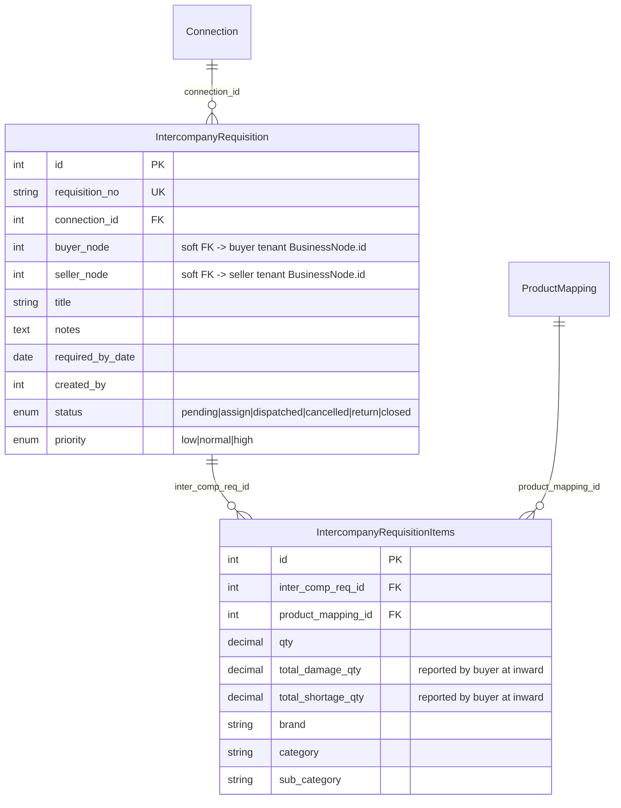

---

## 3. Tenant DB ERD

The tenant schema is large, so it is split into seven domains. `Product`, `BusinessNode`,
`ManufacturingUnit`, `Batch`, and `User` recur across domains — they are the shared spine.

### 3.1 Identity, access & node assignment

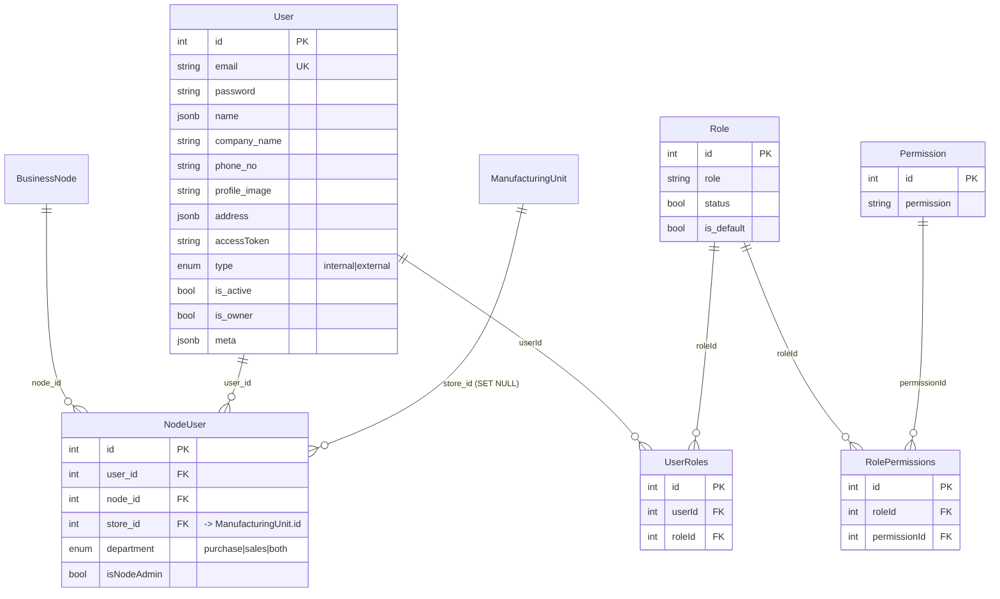

### 3.2 Organisation structure — nodes, stores, warehouses

`BusinessNode` is the tenant-side hub: nearly every transactional table points at one. Note the two
parallel "store" concepts — `ManufacturingUnit` (the operational RM/FG/production store, commented
in code as *"ManufacturingUnit === Store"*) and the newer, simpler `Store` table.

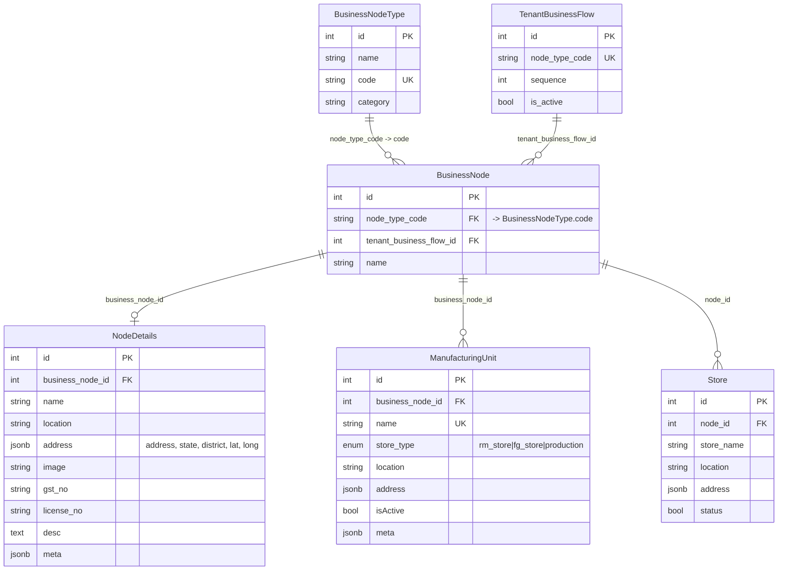

### 3.3 Product master data

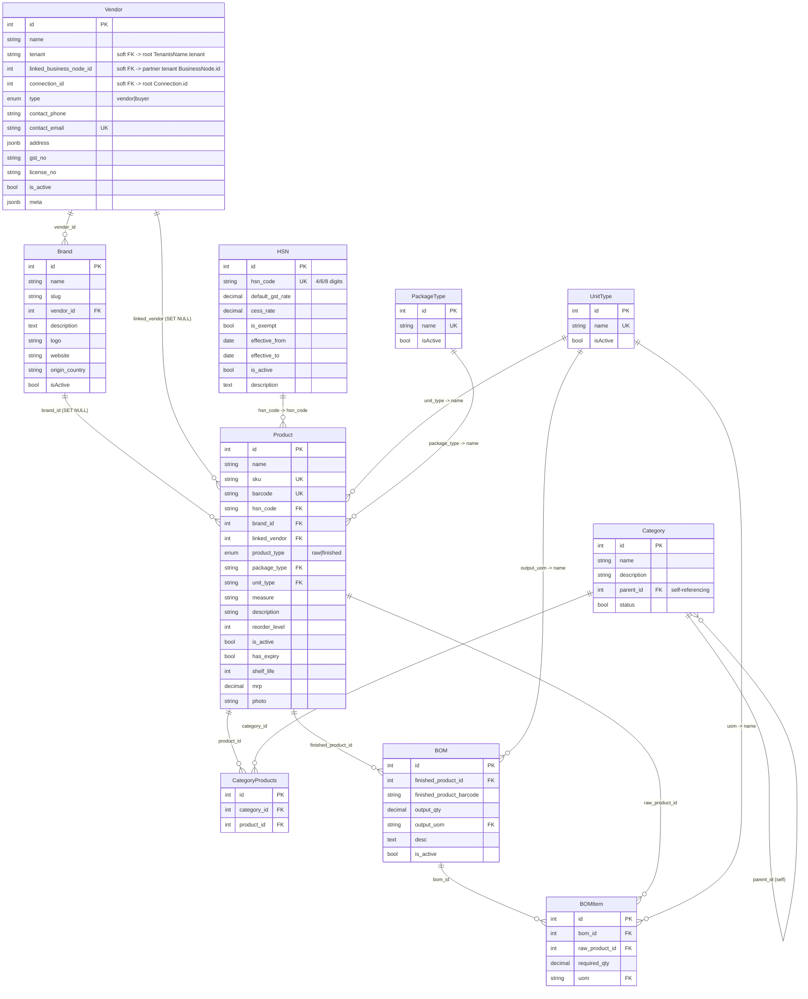

### 3.4 Procurement — Requisition → Quotation → Purchase Order

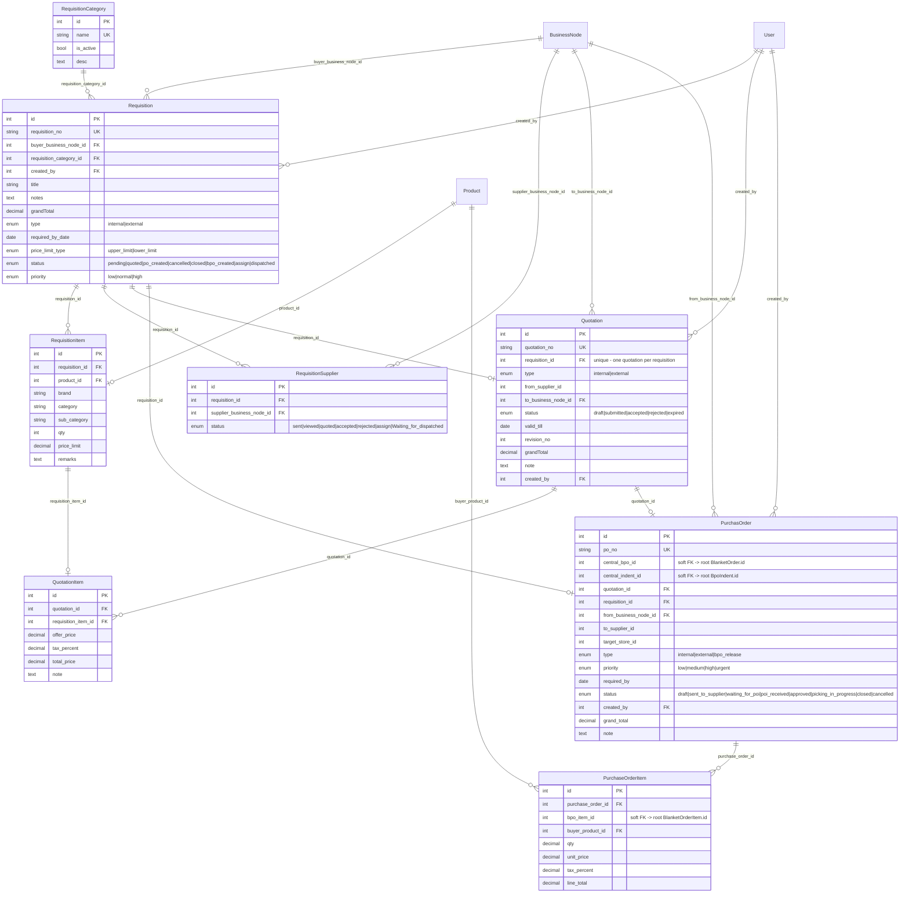

### 3.5 Sales, dispatch & invoicing

```mermaid
erDiagram
    BusinessNode ||--o{ SalesOrder : "seller_business_node_id"
    SalesOrder ||--o{ SalesOrderItem : "sales_order_id"
    Product ||--o{ SalesOrderItem : "vendor_product_id"
    SalesOrder ||--o{ Outward : "sales_order_id"
    BusinessNode ||--o{ Outward : "seller_business_node_id"
    ManufacturingUnit ||--o{ Outward : "store_id"
    Outward ||--o{ OutwardItem : "outward_id"
    SalesOrderItem ||--o{ OutwardItem : "sales_order_item_id"
    Product ||--o{ OutwardItem : "vendor_product_id"
    OutwardItem ||--o{ OutwardAllocation : "outward_item_id"
    Batch ||--o{ OutwardAllocation : "batch_id"
    Outward ||--o{ Invoice : "outward_id"
    BusinessNode ||--o{ Invoice : "seller_businessNode_id"
    ManufacturingUnit ||--o{ Invoice : "seller_store_id"
    Invoice ||--o{ InvoiceItem : "invoice_id"
    Product ||--o{ InvoiceItem : "seller_product_id"

    SalesOrder {
        int id PK
        string so_no UK
        string source_po_no "buyer's PO number, not an id"
        int central_bpo_id "soft FK -> root BlanketOrder.id"
        int central_indent_id "soft FK -> root BpoIndent.id"
        int seller_business_node_id FK
        int buyer_business_node_id "soft FK - may be a remote node"
        enum type "internal|external|bpo_release"
        enum priority "low|medium|high|urgent"
        jsonb delivery_address
        date required_by
        enum status "draft|waiting_for_approval|approved|assign_fg|closed|cancelled"
        decimal grand_total
        text note
        jsonb meta
    }
    SalesOrderItem {
        int id PK
        int sales_order_id FK
        int vendor_product_id FK
        decimal qty
        decimal unit_price
        decimal line_total
    }
    Outward {
        int id PK
        string outward_no UK
        int sales_order_id FK "when type = external"
        string pr_no "requisition_no, when type = internal"
        int seller_business_node_id FK
        int store_id FK "FG store -> ManufacturingUnit.id"
        int buyer_business_node_id "soft FK - internal node or vendor"
        enum type "internal|external"
        int picker_id
        enum priority "low|normal|high|urgent"
        enum status "pending|picking|picked|cancelled|dispatched|return"
        date required_by
        date dispatch_date
        string invoice_no
        jsonb meta
        text note
    }
    OutwardItem {
        int id PK
        int outward_id FK
        int sales_order_item_id FK
        int vendor_product_id FK
        decimal requested_qty
        decimal dispatch_qty
        decimal total_shortage_qty
        decimal total_damage_qty
        decimal unit_price
    }
    OutwardAllocation {
        int id PK
        int outward_item_id FK
        int product_id
        int batch_id FK
        decimal allocated_qty
        decimal shortage_qty
        decimal damage_qty
        enum status "allocated|picked|dispatched"
    }
    Invoice {
        int id PK
        string invoice_no UK
        string seller_tenant "soft FK -> root TenantsName.tenant"
        int seller_businessNode_id FK
        int seller_store_id FK "-> ManufacturingUnit.id"
        string buyer_tenant "soft FK -> root TenantsName.tenant"
        int buyer_businessNode_id "soft FK - buyer tenant BusinessNode.id"
        int outward_id FK
        date invoice_date
        decimal sub_total
        enum tax_type "intra|inter|noTax"
        decimal total_tax_amount
        decimal discount
        decimal grand_total
    }
    InvoiceItem {
        int id PK
        int invoice_id FK
        int seller_product_id FK
        string seller_product_name
        string seller_product_sku
        int buyer_product_id "soft FK - buyer tenant Product.id"
        string buyer_product_name
        string buyer_product_sku
        string hsn_code
        string batch_no
        date mfg_date
        date expiry_date
        decimal unit_price
        decimal qty
        decimal itemLevel_sub_total
        decimal tax_rate
        decimal tax_amount
        decimal itemLevel_grand_total
    }
```

### 3.6 Inventory — batches, inward (GRN), ledger & transfers

`Batch` is the unit of stock. Every movement either creates a batch, allocates from one, or writes a
ledger entry against one.

```mermaid
erDiagram
    Product ||--o{ Batch : "product_id"
    BusinessNode ||--o{ Batch : "location_id"
    ManufacturingUnit ||--o{ Batch : "store_id"

    User ||--o{ GRN : "created_by (SET NULL)"
    PurchasOrder ||--o{ GRN : "purchase_order -> po_no"
    BusinessNode ||--o{ GRN : "receiver_id"
    ManufacturingUnit ||--o{ GRN : "mfg_unit_id"
    GRN ||--o{ GRNItem : "grn_id"
    PurchaseOrderItem ||--o{ GRNItem : "purchase_order_item_id"
    Product ||--o{ GRNItem : "product_id"
    GRNItem ||--o{ GRNItemBatch : "grn_item_id"

    NodeStockLedger ||--o{ NodeStockLedgerItem : "ledger_id"
    Product ||--o{ NodeStockLedgerItem : "product_id"
    Batch ||--o{ NodeStockLedgerItem : "batch_id"

    User ||--o{ TransferOrder : "created_by"
    TransferOrder ||--o{ TransferOrderItem : "transfer_order_id"
    Product ||--o{ TransferOrderItem : "product_id"
    TransferOrderItem ||--o{ TransferOrderAllocation : "transferOrder_item_id"
    Batch ||--o{ TransferOrderAllocation : "batch_id"

    BusinessNode ||--o{ DirectTransfer : "from_location_id"
    BusinessNode ||--o{ DirectTransfer : "target_location_id"
    ManufacturingUnit ||--o{ DirectTransfer : "from_mfg_unit_id"
    User ||--o{ DirectTransfer : "created_by"
    DirectTransfer ||--o{ DirectTransferItem : "dir_transfer_id"
    Product ||--o{ DirectTransferItem : "product_id"
    DirectTransferItem ||--o{ DirectTransferAllocation : "dir_transfer_item_id"
    Batch ||--o{ DirectTransferAllocation : "batch_id"

    Batch {
        int id PK
        string batch_no
        int product_id FK
        int location_id FK "-> BusinessNode.id"
        int store_id FK "-> ManufacturingUnit.id"
        enum location_type "mfg_unit|business_node"
        decimal available_qty
        decimal reserved_qty
        int reference_id "polymorphic"
        enum reference_type "opening_stock|grn|transfer|others|production"
        enum batch_status "active|quarantine|expired|consumed"
        decimal unit_price
        date mfg_date
        date expiry_date
        date received_date
        bool is_active
    }
    GRN {
        int id PK
        string grn_no UK
        string purchase_order FK "-> PurchasOrder.po_no"
        enum grn_type "purchase|transfer|return"
        int sender_id "soft FK - node, may be remote"
        int receiver_id FK "-> BusinessNode.id"
        int mfg_unit_id FK
        date received_date
        enum status "draft|accepted|cancelled|return"
        jsonb reference
        int created_by FK
    }
    GRNItem {
        int id PK
        int grn_id FK
        int purchase_order_item_id FK
        int product_id FK
        decimal ordered_qty
        decimal shortage_qty
        decimal damage_qty
        decimal received_qty
    }
    GRNItemBatch {
        int id PK
        int grn_item_id FK
        string batch_no "supplier batch no if available"
        decimal received_qty
        decimal damage_qty
        decimal shortage_qty
        date expiry_date
    }
    NodeStockLedger {
        int id PK
        string ledger_no
        enum transaction_type "opening_stock|internal_transfer|external_transfer|others"
        date txn_date
        int from_location_id "polymorphic"
        enum from_location_type "mfg_unit|business_node"
        int to_location_id "polymorphic"
        enum to_location_type "mfg_unit|business_node"
        int reference_id "polymorphic"
        enum reference_type "transfer_order|grn|sales_order|others"
        int created_by
    }
    NodeStockLedgerItem {
        int id PK
        int ledger_id FK
        int product_id FK
        int batch_id FK
        decimal qty
        string unit_type
        decimal unit_price
        decimal total_value
    }
    TransferOrder {
        int id PK
        string transfer_no UK
        enum type "material_issue|production_transfer"
        int from_parent_node_id "polymorphic - optional node"
        int from_location_id "polymorphic"
        enum from_location_type "mfg_unit|business_node"
        int to_parent_node_id "polymorphic - optional node"
        int to_location_id "polymorphic"
        enum to_location_type "mfg_unit|business_node"
        date required_date
        enum status "draft|requested|dispatched|received|returns|cancelled"
        int created_by FK
    }
    TransferOrderItem {
        int id PK
        int transfer_order_id FK
        int product_id FK
        decimal requested_qty
        decimal dispatched_qty
        decimal received_qty
    }
    TransferOrderAllocation {
        int id PK
        int transferOrder_item_id FK
        int batch_id FK
        decimal allocated_qty
        decimal demaged_qty
        decimal shortage_qty
    }
    DirectTransfer {
        int id PK
        string dir_trans_no UK
        int from_location_id FK "-> BusinessNode.id"
        int from_mfg_unit_id FK "-> ManufacturingUnit.id"
        int target_location_id FK "-> BusinessNode.id"
        date transfer_date
        enum status "draft|send|accepted|return|cancelled"
        int created_by FK
    }
    DirectTransferItem {
        int id PK
        int dir_transfer_id FK
        int product_id FK
        decimal total_send_qty
        decimal total_damage_qty
        decimal total_shortage_qty
        bool is_return
    }
    DirectTransferAllocation {
        int id PK
        int dir_transfer_item_id FK
        int batch_id FK
        decimal send_qty
        decimal damage_qty
        decimal shortage_qty
    }
```

**GRN direction semantics** (from the note in [grn.model.js](../src/models/grn.model.js)):

| `grn_type` | Sender side | Receiver side |
|---|---|---|
| `purchase` | `sender_id` = seller | `receiver_id` + `mfg_unit_id` = buyer |
| `transfer` | `sender_id` (+ optionally `mfg_unit_id`) | `receiver_id` |

### 3.7 Production

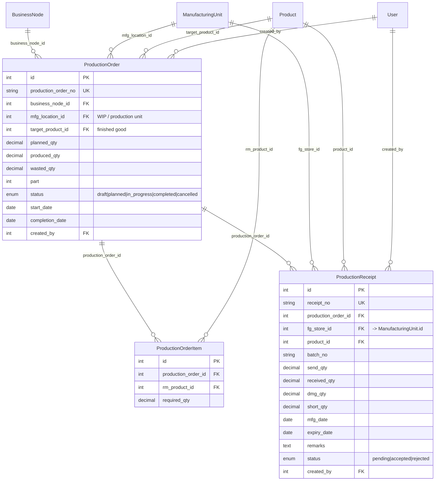

### 3.8 Cost centre

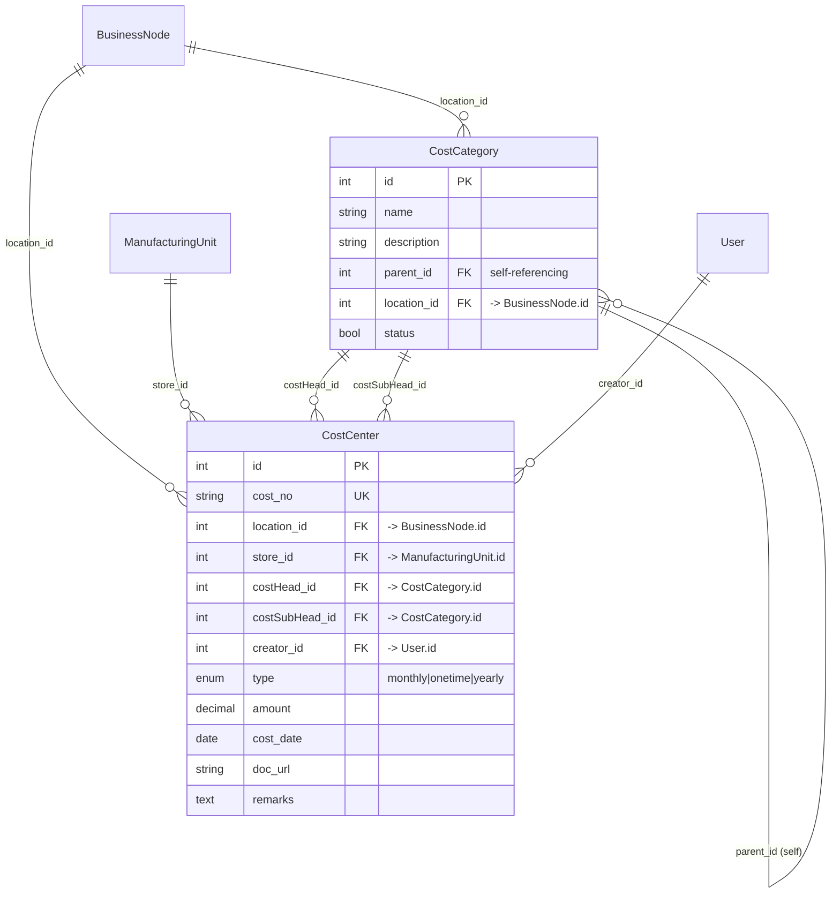

---

## 4. Document flow — how the pieces connect end to end

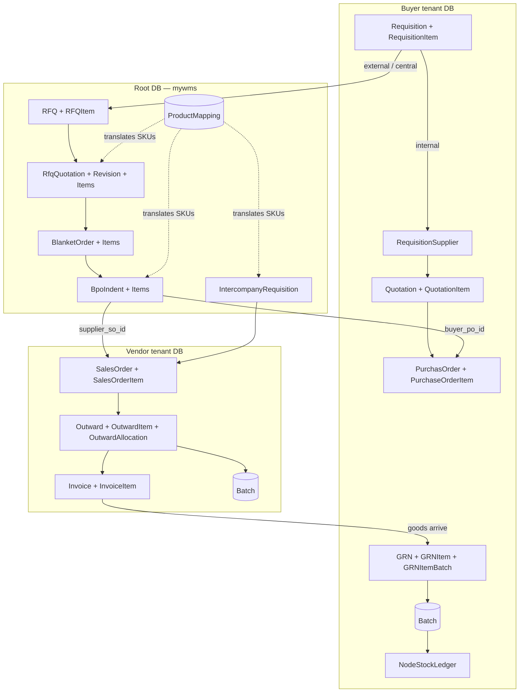

---

## 5. Cross-database soft references

None of these are enforced by a PostgreSQL foreign key — they span database boundaries and must be
validated in application code.

| From (DB.Table.Column) | To | Meaning |
|---|---|---|
| `root.Connection.buyer_tenant` / `.vendor_tenant` | `root.TenantsName.tenant` | Real FK (same DB), keyed on the tenant slug rather than the id |
| `root.ProductMapping.buyer_product_id` | buyer tenant `Product.id` | SKU translation, buyer side |
| `root.ProductMapping.vendor_product_id` | vendor tenant `Product.id` | SKU translation, vendor side |
| `root.RFQItem.product_id` | buyer tenant `Product.id` | Requested item |
| `root.BpoIndent.buyer_po_id` | buyer tenant `PurchasOrder.id` | Populated once the local PO exists |
| `root.BpoIndent.supplier_so_id` | vendor tenant `SalesOrder.id` | Populated once the local SO exists |
| `root.IntercompanyRequisition.buyer_node` | buyer tenant `BusinessNode.id` | Requesting node |
| `root.IntercompanyRequisition.seller_node` | seller tenant `BusinessNode.id` | Fulfilling node |
| `tenant.Vendor.connection_id` | `root.Connection.id` | Which partnership this vendor record represents |
| `tenant.Vendor.tenant` | `root.TenantsName.tenant` | Partner tenant slug |
| `tenant.Vendor.linked_business_node_id` | partner tenant `BusinessNode.id` | Explicitly documented as cross-tenant in the model comment |
| `tenant.PurchasOrder.central_bpo_id` | `root.BlanketOrder.id` | Only set for `bpo_release` POs |
| `tenant.PurchasOrder.central_indent_id` | `root.BpoIndent.id` | Only set for indent-generated POs |
| `tenant.PurchaseOrderItem.bpo_item_id` | `root.BlanketOrderItem.id` | Contract line the release draws down |
| `tenant.SalesOrder.central_bpo_id` / `.central_indent_id` | `root.BlanketOrder.id` / `root.BpoIndent.id` | Vendor-side mirror of the above |
| `tenant.SalesOrder.source_po_no` | buyer tenant `PurchasOrder.po_no` | Stored as the buyer's **PO number string**, not an id |
| `tenant.SalesOrder.buyer_business_node_id` | buyer tenant `BusinessNode.id` | No association declared |
| `tenant.Outward.buyer_business_node_id` | internal `BusinessNode.id` or a `Vendor` | No association declared |
| `tenant.Outward.pr_no` | `Requisition.requisition_no` | Used when `type = internal` |
| `tenant.GRN.sender_id` | `BusinessNode.id` (possibly remote) | Only `receiver_id` has a declared association |
| `tenant.Invoice.seller_tenant` / `.buyer_tenant` | `root.TenantsName.tenant` | Party slugs |
| `tenant.Invoice.buyer_businessNode_id` | buyer tenant `BusinessNode.id` | No association declared |
| `tenant.InvoiceItem.buyer_product_id` | buyer tenant `Product.id` | Denormalised alongside name and SKU |

### Polymorphic (in-tenant) references

These pair an id column with a discriminator column instead of a foreign key:

| Table | Id column | Discriminator | Targets |
|---|---|---|---|
| `Batch` | `reference_id` | `reference_type` | `opening_stock` \| `grn` \| `transfer` \| `others` \| `production` |
| `NodeStockLedger` | `from_location_id`, `to_location_id` | `from_location_type`, `to_location_type` | `mfg_unit` \| `business_node` |
| `NodeStockLedger` | `reference_id` | `reference_type` | `transfer_order` \| `grn` \| `sales_order` \| `others` |
| `TransferOrder` | `from_location_id`, `to_location_id` | `from_location_type`, `to_location_type` | `mfg_unit` \| `business_node` |

> Note on `Batch`: although `location_type` is a discriminator, the associations do bind
> `location_id → BusinessNode.id` and `store_id → ManufacturingUnit.id` as real FKs.

---

## 6. Table inventory

### Root DB (`mywms`) — 24 tables

`TenantsName`, `Tenant`, `State`, `District`, `User`, `Role`, `Permission`, `UserRoles`,
`RolePermissions`, `BusinessNodeType`, `TenantBusinessFlowMaster`, `Connection`, `ProductMapping`,
`RFQ`, `RFQItem`, `RfqQuotation`, `RfqQuotationRevision`, `RfqQuotationItem`, `BlanketOrder`,
`BlanketOrderItem`, `BpoIndent`, `BpoIndentItem`, `IntercompanyRequisition`,
`IntercompanyRequisitionItems`

### Tenant DB — 54 tables

| Domain | Tables |
|---|---|
| Identity & access | `User`, `Role`, `Permission`, `UserRoles`, `RolePermissions`, `NodeUser` |
| Organisation | `BusinessNodeType`, `TenantBusinessFlow`, `BusinessNode`, `NodeDetails`, `ManufacturingUnit`, `Store` |
| Product master | `Product`, `Brand`, `Category`, `CategoryProducts`, `HSN`, `UnitType`, `PackageType`, `Vendor`, `BOM`, `BOMItem` |
| Procurement | `RequisitionCategory`, `Requisition`, `RequisitionItem`, `RequisitionSupplier`, `Quotation`, `QuotationItem`, `PurchasOrder`, `PurchaseOrderItem` |
| Sales & dispatch | `SalesOrder`, `SalesOrderItem`, `Outward`, `OutwardItem`, `OutwardAllocation`, `Invoice`, `InvoiceItem` |
| Inventory | `Batch`, `GRN`, `GRNItem`, `GRNItemBatch`, `NodeStockLedger`, `NodeStockLedgerItem`, `TransferOrder`, `TransferOrderItem`, `TransferOrderAllocation`, `DirectTransfer`, `DirectTransferItem`, `DirectTransferAllocation` |
| Production | `ProductionOrder`, `ProductionOrderItem`, `ProductionReceipt` |
| Costing | `CostCategory`, `CostCenter` |

### Dormant model files (not registered in `index.model.js`)

These `.model.js` files exist but are never passed to `defineRootModels()` or `defineTenantModels()`,
so **no table is created for them**:

| File | Note |
|---|---|
| [purchaseInvoice.model.js](../src/models/purchaseInvoice.model.js) | Not imported at all |
| [purchaseInvoiceItems.model.js](../src/models/purchaseInvoiceItems.model.js) | Not imported at all |
| [requestOrder.joinModel.js](../src/models/requestOrder.joinModel.js) | Not imported at all |
| [brandProduct.joinModel.js](../src/models/brandProduct.joinModel.js) | Imported but commented out; the `Product ↔ Brand` many-to-many is commented out too — `Product.brand_id` is a plain one-to-many instead |

---

## 7. Naming quirks worth knowing

| Quirk | Detail |
|---|---|
| `PurchasOrder` | Missing "e" — model name, table `PurchasOrders`, and every association alias use this spelling |
| `ManufacturingUnit` vs `Store` | `ManufacturingUnit` is the operational store (`rm_store` / `fg_store` / `production`) and is what `store_id` columns point to across GRN, Outward, Batch, CostCenter, NodeUser, ProductionReceipt. The separate `Store` table is a newer, thinner record linked only to `BusinessNode` |
| `buyer_tenant` / `vendor_tenant` | Marked "Depriciate name" in [connection.model.js](../src/models/main/connection.model.js) — they hold tenant slugs, and the roles are not always literally buyer/vendor |
| `supplier` vs `vendor` | Used interchangeably (see the comment on `BpoIndent.supplier_so_id`) |
| `demaged_qty` | `TransferOrderAllocation` spells it this way; the sibling tables use `damage_qty` / `total_damage_qty` |
| Denormalised strings | `RequisitionItem` and `IntercompanyRequisitionItems` store `brand` / `category` / `sub_category` as free text rather than FKs — the corresponding `belongsTo` associations are commented out |
